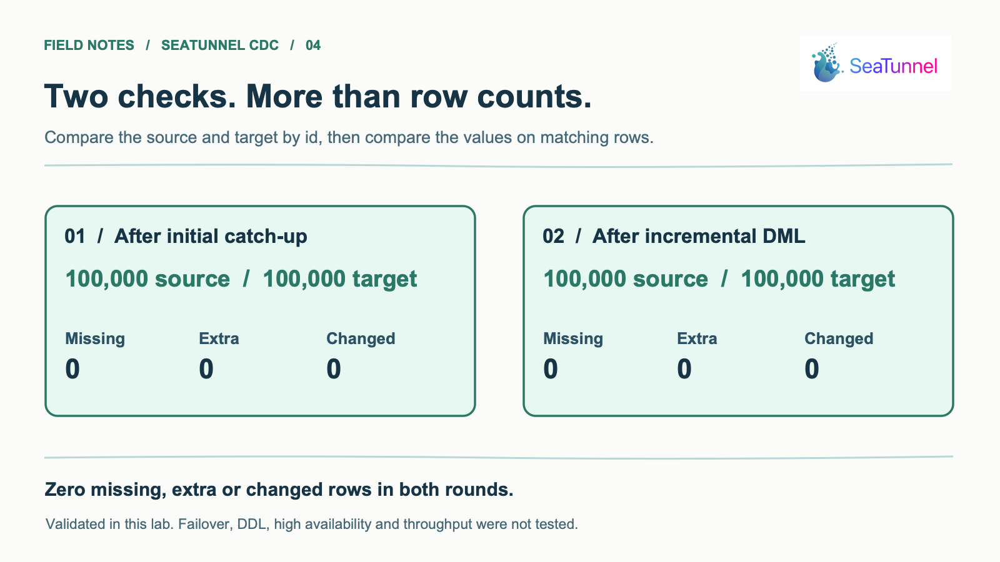

# 历史订单与实时变化，如何接成一条同步链路？用 SeaTunnel 在 Kubernetes 上运行 MySQL CDC

[下载可复现包：配置、SQL、四张图和两份对账结果](seatunnel-kubernetes-cdc-lab.zip)

给报表库同步订单，真正困难的不是第一次复制数据，而是复制期间业务仍在继续：新订单不断写入，已有订单被支付、退款或取消。若先导出整张表，再从另一个时刻开始订阅变更，中间的交接就需要自己处理。

Apache SeaTunnel 是一款高性能、分布式、支持多种数据源的数据集成工具。它通过连接器完成数据读取与写入，让工程师用作业配置组织同步流程，不必为每一组数据源重新编写搬运程序。对于 MySQL，CDC 连接器可以把已有数据的读取与 binlog 中的持续变化串起来；目标连接器则负责把变化转换为目标系统的写入操作。

本文选择一条具体链路：**MySQL 业务订单表 → SeaTunnel MySQL CDC → MySQL 报表订单表**。重点不是增加组件，而是把历史数据、持续更新和删除放进同一条可检查的同步流程。部署采用 SeaTunnel 3.1.0 官方 Kubernetes Local Mode，作业配置通过 ConfigMap 挂载，运行入口直接使用发行包内的 `seatunnel.sh`。

## 1. 先明确目标：同步的是订单当前状态

源表 `shop.orders` 和目标表 `reporting.orders` 都以 `id` 为主键，保存 `status` 与 `amount`。当订单状态改变时，报表库应更新同一个订单；订单删除时，目标表也应删除它。

这与保存每一条变化事件不同。当前状态表依靠稳定的主键识别记录，不能用“所有变化都追加一行”的方式代替更新与删除。这里使用 JDBC Sink 的自动 SQL 生成能力，把 `id` 配置为主键，并提前创建目标表。

为了降低首次运行的环境成本，随文配置把两个数据库放在同一个 MySQL Pod 中。真实业务使用独立实例时，分别替换 Source 和 Sink 的地址与凭据即可；两边的数据库、表和账号权限仍应各自明确。


## 2. 用 Kubernetes 管运行，用 SeaTunnel 管同步

这条链路包含三个 Kubernetes 对象职责：

- MySQL Service 为作业提供稳定的集群内访问地址。
- ConfigMap 保存 SeaTunnel 作业配置。
- SeaTunnel Pod 使用固定镜像启动同步作业。

本文使用的 Local Mode 是官方提供的单 Pod 验证方式，适合检查镜像、连接器与作业配置。长期运行的生产部署应使用官方的 Master/Worker 分离集群方式，并配置共享 Checkpoint、MapStore、服务发现和资源调度。把单 Pod 放进 Kubernetes，并不会自动变成具有集群高可用的 SeaTunnel 部署。

### 准备固定版本的镜像

使用完整的 Apache SeaTunnel 3.1.0 二进制发行包，并按照发布页面校验签名和摘要。镜像中预置本作业需要的 `connector-cdc-mysql-3.1.0.jar`、`connector-jdbc-3.1.0.jar` 和 MySQL JDBC 驱动，避免 Pod 启动时临时下载依赖。

随文 Dockerfile 沿用官方 Kubernetes 文档的发行包镜像方式：

```dockerfile
FROM eclipse-temurin:11-jdk
ADD apache-seatunnel-3.1.0-bin.tar.gz /opt/
RUN mv /opt/apache-seatunnel-3.1.0 /opt/seatunnel
COPY connector-cdc-mysql-3.1.0.jar connector-jdbc-3.1.0.jar /opt/seatunnel/connectors/
COPY mysql-connector-j-8.4.0.jar /opt/seatunnel/lib/
ENV SEATUNNEL_HOME=/opt/seatunnel
WORKDIR /opt/seatunnel
```

这是基于官方发行包构建、预置了本条链路依赖的作业镜像。构建后，把它推送到节点可以访问的镜像仓库；本地集群则按集群工具支持的方式加载镜像。Pod 的 `image` 必须与实际可用的镜像一致。完整依赖获取、构建和节点导入命令见随文 [镜像准备说明](PREPARE-IMAGE.md)。先创建下一节的隔离集群，再按说明构建并加载镜像，最后应用部署清单。

### 为链路建立独立命名空间

随文资源使用 `st-a02-310`。在新的独立 kind 集群和 kubeconfig 中运行，不要用默认的 kubectl 上下文，也不要复用业务命名空间。以下命令假设你在随文文件目录中使用 Bash。

```bash
ST_LAB_KUBECONFIG="$PWD/kubeconfig.st-a02-310"
kind create cluster --name st-a02-310 --kubeconfig "$ST_LAB_KUBECONFIG"

lab_kubectl() {
  kubectl --kubeconfig "$ST_LAB_KUBECONFIG" --context kind-st-a02-310 "$@"
}
lab_kubectl get nodes
```

请先确认节点是此次新建的测试节点，再按 [镜像准备说明](PREPARE-IMAGE.md)加载镜像并继续。若集群名冲突或节点不符，停止，不要套用到其他集群。以下命令均通过同一终端里的 `lab_kubectl` 执行。MySQL 仅提供 ClusterIP Service，不向宿主机或公网开放端口。两个测试 Pod 均使用专用 ServiceAccount，并关闭不需要的 API 凭据自动挂载。

```bash
lab_kubectl create namespace st-a02-310
lab_kubectl -n st-a02-310 create serviceaccount article-local
lab_kubectl -n st-a02-310 create secret generic mysql-local \
  --from-literal=root-password=Article02_local_only
lab_kubectl apply -f mysql.yaml
lab_kubectl -n st-a02-310 wait --for=condition=Ready pod/mysql --timeout=180s
```

这里的固定口令只用于隔离的本地教学环境。生产凭据应由 Secret 或企业密钥服务管理，不能照抄示例口令。MySQL 示例使用临时存储，删除 Pod 会丢失这份测试数据；真实数据库应采用持久化存储或托管数据库。

MySQL 需要启用 binlog，使用 `ROW` 格式和 `FULL` 行镜像。CDC 账号需要读取表及复制相关权限，目标账号需要目标表的读写权限。随文 `seed.sql` 在新环境中执行一次，建立两张订单表并写入 100,000 行初始订单。

```bash
lab_kubectl -n st-a02-310 exec -i mysql -- sh -c \
  'MYSQL_PWD="$MYSQL_ROOT_PASSWORD" mysql -uroot' < seed.sql
```

## 3. 把历史读取与持续增量写在同一份配置中

`startup.mode = "initial"` 指定首次运行先读取历史数据，再继续捕获 binlog。快照按分片读取，分片大小和抓取批次分别由 `snapshot.split.size` 与 `snapshot.fetch.size` 控制。它们决定读取组织方式，不是吞吐承诺。

```hocon
env {
  parallelism = 1
  job.mode = "STREAMING"
  checkpoint.interval = 10000
}
source {
  MySQL-CDC {
    url = "jdbc:mysql://mysql:3306/shop"
    username = "cdc"
    password = "Article02_cdc_only"
    table-names = ["shop.orders"]
    server-id = 181103
    startup.mode = "initial"
    snapshot.split.size = 1000
    snapshot.fetch.size = 128
    exactly_once = true
    debezium {
      "database.sessionVariables" = "transaction_isolation='READ-COMMITTED'"
    }
  }
}
sink {
  Jdbc {
    url = "jdbc:mysql://mysql:3306/reporting"
    driver = "com.mysql.cj.jdbc.Driver"
    user = "writer"
    password = "Article02_writer_only"
    generate_sink_sql = true
    primary_keys = ["id"]
    database = "reporting"
    table = "orders"
    schema_save_mode = "ERROR_WHEN_SCHEMA_NOT_EXIST"
    data_save_mode = "APPEND_DATA"
  }
}
```

目标表已提前创建，并具有 `id` 物理主键，`primary_keys = ["id"]` 用来定位同一条订单。MySQL 方言通过 `INSERT ... ON DUPLICATE KEY UPDATE` 维护当前记录，删除事件则按键删除；仅在作业中填写主键名称，并不会给现有目标表自动增加唯一约束。不要把 `APPEND_DATA` 这个数据保存模式理解成“所有 CDC 变化都只做 INSERT”：实际写入还取决于输入行的变更类型、主键和 JDBC 连接器生成的 SQL。

同样，Source 的 `exactly_once` 不能单独证明整条链路具备端到端事务保证。本例没有配置 JDBC XA。这里要解决并检查的是历史与增量衔接以及目标表当前状态，而不是把一个开关宣传为所有故障场景的完整保证。

这里将 CDC 会话显式设置为 `READ-COMMITTED`；它是本篇选定的会话配置，不代表所有部署都必须修改数据库全局隔离级别。

生产作业中，账号口令不要与非敏感配置共同公开分发。Kubernetes 不会替 ConfigMap 中任意一段文本自动执行 `secretKeyRef` 替换，应采用 SeaTunnel 支持的凭据读取方式，并检查容器内最终得到的配置。


## 4. 用官方启动入口运行作业

```bash
lab_kubectl -n st-a02-310 create configmap seatunnel-job-config \
  --from-file=job.conf=config/job.conf
lab_kubectl apply -f seatunnel.yaml
lab_kubectl -n st-a02-310 logs -f seatunnel-local
```

Pod 直接执行：

```text
/opt/seatunnel/bin/seatunnel.sh --config /data/job.conf -e local
```

这与官方 Local Mode 示例使用的是同一个 SeaTunnel 作业入口。ConfigMap 挂载的是配置文件，真正执行读取、Checkpoint 和目标写入的是 SeaTunnel 引擎与连接器。


## 5. 验收应覆盖变化发生的时刻

Pod 处于 Running 只说明进程启动了。对这次有并发写入的快照，验收看两个收敛时点：快照结束并追平当时的变更以后，以及纯增量阶段再次写入并追平以后。

**第一阶段：开始读取历史数据。** 先从日志确认快照开始。因为下一步会在快照进行期间改动源表，本次没有单独对一个未发生任何变更的初始副本出具对账结果。

**第二阶段：快照期间持续写入。** 在日志明确显示快照正在执行后，更新主键前段、中段和后段的订单，同时插入新订单、删除已有订单。这样能覆盖不同分片位置，而不只是快照结束后写一条数据。

**第三阶段：进入持续增量后继续修改。** 再更新订单状态与金额，执行新增和删除，确认报表表随之变化。

先打开一个 SQL 会话：

```bash
lab_kubectl -n st-a02-310 exec -it mysql -- sh -c 'MYSQL_PWD="$MYSQL_ROOT_PASSWORD" mysql -uroot'
```

快照正在执行时，在该会话执行以下事务。它在三个主键区段修改订单，并新增一行、删除一行：

```sql
START TRANSACTION;
UPDATE shop.orders SET status='paid', amount=30.00
WHERE id BETWEEN 1 AND 100
   OR id BETWEEN 50001 AND 50100
   OR id BETWEEN 99901 AND 100000;
INSERT INTO shop.orders VALUES(100001,'created',25.00);
DELETE FROM shop.orders WHERE id=1;
COMMIT;
```

完成快照并追赶到持续增量后，先执行后文的 `reconcile.sql` 完成第一轮逐键对账，同时检查 `reporting.orders` 中 100001 已存在、1 已删除，再执行下一组 SQL。这样后续删除才是在删除一条已同步记录，而不是对不存在的主键做无效操作。

在持续增量阶段执行：

```sql
UPDATE shop.orders SET status='shipped', amount=45.50 WHERE id=2;
INSERT INTO shop.orders VALUES(100002,'created',19.90);
DELETE FROM shop.orders WHERE id=100001;
```

最终检查不仅比较行数，还要找出缺失主键、额外主键与同一主键的字段差异。行数相等可能掩盖“一条遗漏、一条多余”。随文 `reconcile.sql` 使用逐键连接，并对状态字符串做区分大小写的比较。

```bash
lab_kubectl -n st-a02-310 exec -i mysql -- sh -c \
  'MYSQL_PWD="$MYSQL_ROOT_PASSWORD" mysql -uroot' < reconcile.sql
```

业务验收的目标是：目标表没有缺失记录，没有额外记录，同一主键的状态和金额一致。对持续写入的业务，应在约定的追赶窗口后比较一致时点，而不是拿仍在变化的两次查询结果直接下结论。

### 本条链路的运行结果

这份作业配置在独立 kind 集群的 Kubernetes v1.36.1、SeaTunnel 3.1.0、Java 11.0.33 和 MySQL 8.0.46 下完成了上述流程。快照读取期间，在前段、中段与后段主键范围修改订单，同时新增 `100001`、删除 `1`；日志随后确认进入持续增量阶段。

两次逐键检查得到以下结果。随文保留了两份对账输出： [快照追平后](reconciliation-snapshot-310.tsv)、[纯增量追平后](reconciliation-incremental-310.tsv)。

| 检查项目 | 快照期间变更追平后 | 后续增量变更追平后 |
| --- | ---: | ---: |
| 源表行数 | 100,000 | 100,000 |
| 目标表行数 | 100,000 | 100,000 |
| 缺失记录 | 0 | 0 |
| 额外记录 | 0 | 0 |
| 同一主键字段不一致 | 0 | 0 |

最后，订单 `2` 的状态与金额为 `shipped / 45.50`，新增订单 `100002` 为 `created / 19.90`，订单 `1` 与 `100001` 已从目标表删除。这验证了本地单 Pod 作业在这组数据下的存量与增量衔接，以及目标表按主键收敛。没有测故障恢复、XA 端到端事务、DDL、集群高可用或吞吐，不能把结果外推到这些场景。



## 6. 从一条订单链路走向长期运行

这条链路把原本需要分别安排的历史导入和持续增量纳入同一个作业，主键把源端变化与目标记录连接起来。工程师可以围绕一份配置管理连接器和同步行为，并用明确的业务结果判断接入是否成功。

进入生产前，部署关注点从“单条链路能运行”转向“服务能持续运行”：采用官方推荐的分离集群，给 Master 与 Worker 配置共享状态存储，保留足够的 binlog 历史，并在目标部署形态下演练停机与恢复。主键、源日志、状态存储和目标写入语义共同决定恢复结果，不能由 Pod 自动重建代替验收。

下一步可以从一张有稳定主键的业务表开始，完成历史装载与增删改检查，再扩展表范围和资源规模。对第一次接触 SeaTunnel 的团队，这比一次引入大量组件更容易建立起可理解、可运维的数据同步流程。

## 参考资料

- [Apache SeaTunnel 官网](https://seatunnel.apache.org/)
- [3.1.0 Kubernetes 部署](https://seatunnel.apache.org/docs/3.1.0/getting-started/kubernetes/)
- [3.1.0 Kubernetes Local Mode](https://seatunnel.apache.org/docs/3.1.0/getting-started/kubernetes/local-mode/)
- [3.1.0 Kubernetes 配置](https://seatunnel.apache.org/docs/3.1.0/getting-started/kubernetes/configuration/)
- [3.1.0 MySQL CDC](https://seatunnel.apache.org/docs/3.1.0/connectors/source/MySQL-CDC/)
- [3.1.0 JDBC Sink](https://seatunnel.apache.org/docs/3.1.0/connectors/sink/Jdbc/)
