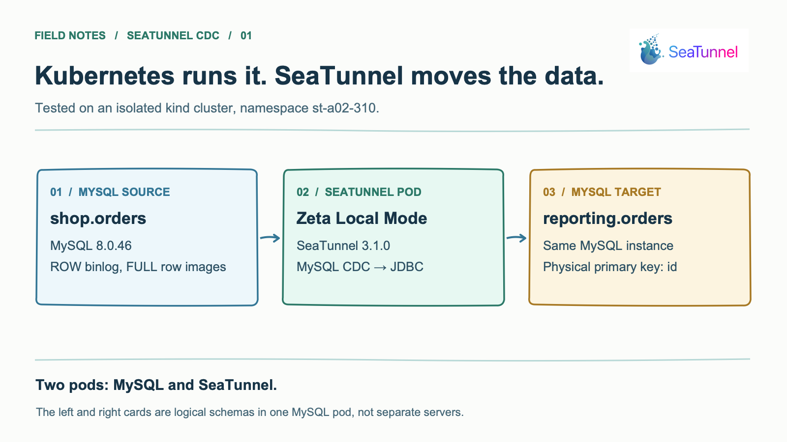
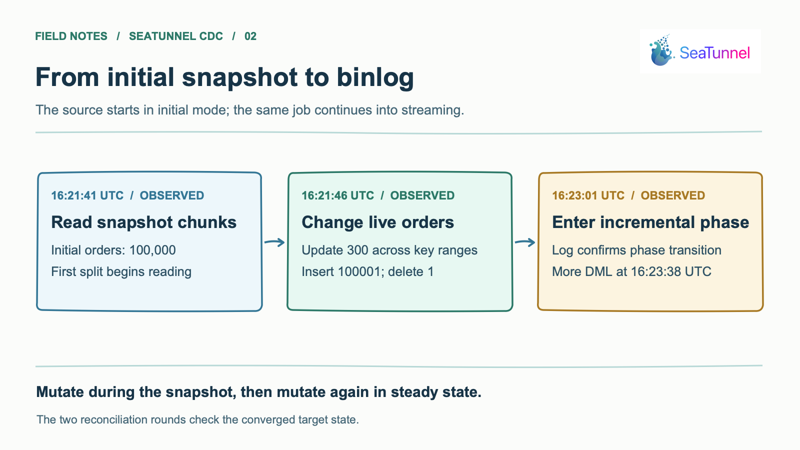
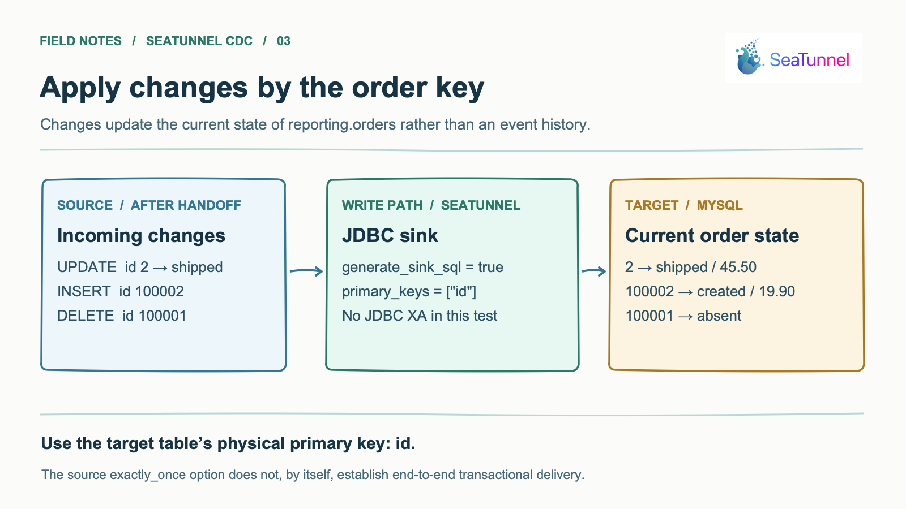

# MySQL CDC on Kubernetes with Apache SeaTunnel: Verifying the Snapshot-to-Binlog Handoff

If you’re replacing a full export with change data capture (CDC), make one acceptance test nonnegotiable: change rows while the initial snapshot is still reading, then compare the source and target by primary key. A row count won’t catch a missing order if a stray order takes its place.

This walkthrough uses Apache SeaTunnel 3.1.0 to replicate a MySQL orders table into a MySQL reporting table. The SeaTunnel MySQL CDC connector reads the initial snapshot and continues from the binlog; the JDBC sink applies changes to the reporting table. In one isolated kind run, we loaded 100,000 orders and compared the tables twice: after catching up with changes made during the snapshot, and again after a second set of changes in the streaming phase.

[Download the reproducible project](https://github.com/davidzollo/seatunnel-kubernetes-cdc-lab/blob/main/seatunnel-kubernetes-cdc-lab.zip) for the manifests, job configuration, SQL, figures, and evidence. The [companion repository](https://github.com/davidzollo/seatunnel-kubernetes-cdc-lab) also has both reconciliation outputs.

## 1. Decide what the target should contain

The target is a current-state table, not a history of every change event. Both `shop.orders` and `reporting.orders` have an `id` primary key and store `status` and `amount`. When an order changes, the reporting table must update the existing row. When an order is deleted, its row must disappear from the target.

Create the target table before starting the job. Configure the SeaTunnel JDBC sink to generate SQL and use `id` as the key. For this walkthrough, both databases live in the same MySQL Pod to keep setup small. With separate instances, set the source and sink endpoints and credentials separately, and verify each account’s permissions.



## 2. Run the job in an isolated Kubernetes cluster

The MySQL Service gives the job a stable in-cluster endpoint. A ConfigMap holds the SeaTunnel job configuration. A single SeaTunnel Pod runs the job using a versioned image.

This uses the official [SeaTunnel Kubernetes Local Mode](https://seatunnel.apache.org/docs/3.1.0/getting-started/kubernetes/local-mode/) to verify the image, connectors, and configuration. A single Pod is not a highly available SeaTunnel cluster. For a long-running production deployment, use the documented separated Master/Worker mode and configure shared checkpoint storage, MapStore, service discovery, and resource scheduling.

### Prepare the image

Start with the full Apache SeaTunnel 3.1.0 binary distribution. Before building, verify its [release signature](https://downloads.apache.org/seatunnel/3.1.0/apache-seatunnel-3.1.0-bin.tar.gz.asc) and [SHA-512 digest](https://downloads.apache.org/seatunnel/3.1.0/apache-seatunnel-3.1.0-bin.tar.gz.sha512) from the [Apache SeaTunnel download page](https://seatunnel.apache.org/download/). Put the MySQL CDC and JDBC connector JARs and the MySQL JDBC driver in the job image so the Pod doesn’t need to download them at startup. The Dockerfile follows the distribution-based image approach in the Kubernetes documentation:

```dockerfile
FROM eclipse-temurin:11-jdk
ADD apache-seatunnel-3.1.0-bin.tar.gz /opt/
RUN mv /opt/apache-seatunnel-3.1.0 /opt/seatunnel
COPY connector-cdc-mysql-3.1.0.jar connector-jdbc-3.1.0.jar /opt/seatunnel/connectors/
COPY mysql-connector-j-8.4.0.jar /opt/seatunnel/lib/
ENV SEATUNNEL_HOME=/opt/seatunnel
WORKDIR /opt/seatunnel
```

Put the verified distribution in `build/` with its original filename. Download the [MySQL CDC connector](https://repo.maven.apache.org/maven2/org/apache/seatunnel/connector-cdc-mysql/3.1.0/connector-cdc-mysql-3.1.0.jar), [JDBC connector](https://repo.maven.apache.org/maven2/org/apache/seatunnel/connector-jdbc/3.1.0/connector-jdbc-3.1.0.jar), and [MySQL JDBC driver](https://repo.maven.apache.org/maven2/com/mysql/mysql-connector-j/8.4.0/mysql-connector-j-8.4.0.jar) into the same directory. From the extracted project root, build with `docker build -t st-a02-k8s:3.1.0 build/`. For a remote cluster, push the image to a registry the nodes can reach and set the Pod’s `image` accordingly.

### Create a dedicated namespace

Start from the extracted project directory in Bash. Use a dedicated kind cluster and kubeconfig, not your default kubectl context or an existing application namespace:

```bash
ST_LAB_KUBECONFIG="$PWD/kubeconfig.st-a02-310"
kind create cluster --name st-a02-310 --kubeconfig "$ST_LAB_KUBECONFIG"

lab_kubectl() {
  kubectl --kubeconfig "$ST_LAB_KUBECONFIG" --context kind-st-a02-310 "$@"
}
lab_kubectl get nodes
```

Confirm the node list belongs to the cluster you just created. If the cluster name already exists or the nodes aren’t the ones you expect, stop. Build the job image as described above, pull `mysql:8.0.46`, and then run `kind load docker-image mysql:8.0.46 st-a02-k8s:3.1.0 --name st-a02-310`. The [image preparation guide](https://github.com/davidzollo/seatunnel-kubernetes-cdc-lab/blob/main/PREPARE-IMAGE.md) documents the node-local import fallback used in this run. Run the remaining `lab_kubectl` commands in the same shell.

The MySQL Service is a ClusterIP, with no port exposed to the host or the public Internet. Both Pods use a dedicated ServiceAccount with automatic API credential mounting disabled.

```bash
lab_kubectl create namespace st-a02-310
lab_kubectl -n st-a02-310 create serviceaccount article-local
lab_kubectl -n st-a02-310 create secret generic mysql-local \
  --from-literal=root-password=Article02_local_only
lab_kubectl apply -f mysql.yaml
lab_kubectl -n st-a02-310 wait --for=condition=Ready pod/mysql --timeout=180s
```

The fixed passwords are for this isolated local environment only. Use Kubernetes Secrets or your organization’s secret manager for production credentials. The example MySQL Pod uses ephemeral storage; deleting it discards the sample data. An actual database needs persistent storage or a managed service.

MySQL must have binary logging enabled with `ROW` format and `FULL` row images. The CDC account needs table reads and replication privileges; the sink account needs read and write access to the target table. Run `seed.sql` once in the fresh environment to create both orders tables and load 100,000 source rows:

```bash
lab_kubectl -n st-a02-310 exec -i mysql -- sh -c \
  'MYSQL_PWD="$MYSQL_ROOT_PASSWORD" mysql -uroot' < seed.sql
```

## 3. Configure the snapshot and stream as one job

On the initial run, `startup.mode = "initial"` reads existing rows before continuing to capture binlog changes. `snapshot.split.size` controls the snapshot split size; `snapshot.fetch.size` controls the fetch batch size. Neither is a throughput guarantee.

```hocon
env {
  parallelism = 1
  job.mode = "STREAMING"
  checkpoint.interval = 10000
}
source {
  MySQL-CDC {
    url = "jdbc:mysql://mysql:3306/shop"
    username = "cdc"
    password = "Article02_cdc_only"
    table-names = ["shop.orders"]
    server-id = 181103
    startup.mode = "initial"
    snapshot.split.size = 1000
    snapshot.fetch.size = 128
    exactly_once = true
    debezium {
      "database.sessionVariables" = "transaction_isolation='READ-COMMITTED'"
    }
  }
}
sink {
  Jdbc {
    url = "jdbc:mysql://mysql:3306/reporting"
    driver = "com.mysql.cj.jdbc.Driver"
    user = "writer"
    password = "Article02_writer_only"
    generate_sink_sql = true
    primary_keys = ["id"]
    database = "reporting"
    table = "orders"
    schema_save_mode = "ERROR_WHEN_SCHEMA_NOT_EXIST"
    data_save_mode = "APPEND_DATA"
  }
}
```

The target already has a physical primary key on `id`. The MySQL dialect uses `INSERT ... ON DUPLICATE KEY UPDATE` to write the current row and deletes by key on a delete event. Setting `primary_keys` in the job does not add a unique constraint to an existing table. Likewise, `data_save_mode = "APPEND_DATA"` does not turn every CDC event into an insert. The operation also depends on the incoming row’s change type, the key, and the SQL the connector generates.

The source’s `exactly_once` setting does not establish an end-to-end transaction guarantee. This job does not configure JDBC XA. The goal here is to verify the snapshot-to-binlog handoff and the target’s current state. The example also sets the CDC session to `READ-COMMITTED`; it does not require changing MySQL’s global isolation level.

Keep production credentials separate from configuration you distribute. Kubernetes does not substitute a `secretKeyRef` inside arbitrary text mounted from a ConfigMap. Use a credential mechanism supported by SeaTunnel and verify the effective configuration inside the container.



## 4. Start the job with the SeaTunnel distribution

```bash
lab_kubectl -n st-a02-310 create configmap seatunnel-job-config \
  --from-file=job.conf=config/job.conf
lab_kubectl apply -f seatunnel.yaml
lab_kubectl -n st-a02-310 logs -f seatunnel-local
```

The Pod runs:

```text
/opt/seatunnel/bin/seatunnel.sh --config /data/job.conf -e local
```

That’s the same job entry point the official Local Mode example uses. The ConfigMap supplies the configuration file; SeaTunnel and its connectors handle reads, checkpoints, and target writes.



## 5. Reconcile twice, with writes on both sides of the handoff

A Running Pod tells you the process started. It doesn’t tell you whether the target caught up. This run checks the target at two points: after the snapshot and its concurrent writes have caught up, and after a separate round of writes during streaming. It does not include a separate reconciliation of an unchanged initial snapshot.

Open a SQL session:

```bash
lab_kubectl -n st-a02-310 exec -it mysql -- sh -c 'MYSQL_PWD="$MYSQL_ROOT_PASSWORD" mysql -uroot'
```

**While the snapshot is running**, verify that the logs show snapshot activity, then run this transaction. It touches three ranges of primary keys and includes both an insert and a delete:

```sql
START TRANSACTION;
UPDATE shop.orders SET status='paid', amount=30.00
WHERE id BETWEEN 1 AND 100
   OR id BETWEEN 50001 AND 50100
   OR id BETWEEN 99901 AND 100000;
INSERT INTO shop.orders VALUES(100001,'created',25.00);
DELETE FROM shop.orders WHERE id=1;
COMMIT;
```

Once the snapshot completes and the stream catches up, run the reconciliation command below for the first time. Check that order `100001` exists in `reporting.orders` and that order `1` does not. This makes the next delete a test against a row that was actually replicated, not a delete against a key the target never had.

**During steady-state streaming**, run a second set of changes:

```sql
UPDATE shop.orders SET status='shipped', amount=45.50 WHERE id=2;
INSERT INTO shop.orders VALUES(100002,'created',19.90);
DELETE FROM shop.orders WHERE id=100001;
```

After each phase has caught up, compare the tables with `reconcile.sql`:

```bash
lab_kubectl -n st-a02-310 exec -i mysql -- sh -c \
  'MYSQL_PWD="$MYSQL_ROOT_PASSWORD" mysql -uroot' < reconcile.sql
```

The query checks for missing keys, extra keys, and mismatched fields on the same key. It compares status text case-sensitively. In a system that keeps accepting writes, reconcile at an agreed comparison point after catch-up; two queries taken against tables that are still changing don’t establish consistency.

### Results from the isolated run

Both checks were run in the same isolated kind cluster with Kubernetes v1.36.1, SeaTunnel 3.1.0, Java 11.0.33, and MySQL 8.0.46. The logs confirmed the transition to streaming after the writes made during the snapshot. The raw outputs are available for [snapshot catch-up](https://github.com/davidzollo/seatunnel-kubernetes-cdc-lab/blob/main/reconciliation-snapshot-310.tsv) and [streaming catch-up](https://github.com/davidzollo/seatunnel-kubernetes-cdc-lab/blob/main/reconciliation-incremental-310.tsv).

| Check | After snapshot catch-up | After streaming catch-up |
| --- | ---: | ---: |
| Source rows | 100,000 | 100,000 |
| Target rows | 100,000 | 100,000 |
| Missing rows | 0 | 0 |
| Extra rows | 0 | 0 |
| Keys with field mismatches | 0 | 0 |

At the final check, order `2` showed `shipped / 45.50`, new order `100002` showed `created / 19.90`, and orders `1` and `100001` were absent from the target.

This verifies that this single-Pod job handled the snapshot-to-binlog handoff and converged by primary key for the changes tested. The run did **not** test failure recovery, end-to-end XA transactions, DDL, cluster high availability, or throughput. The 100,000 figure is a row count, not a benchmark.


## 6. Before moving beyond one Pod

Start with one business table that has a stable primary key. Get the initial load and the insert, update, and delete checks to pass before adding more tables or resources.

For a production rollout, move to the separated cluster deployment, configure shared state storage for the Master and Workers, retain enough binlog history, and rehearse stopping and recovering the job in the deployment you plan to run. Recovery depends on the key, retained source log, stored job state, and how the target applies writes. A replacement Pod alone doesn’t prove the pipeline recovered correctly.

## References

- [Apache SeaTunnel](https://seatunnel.apache.org/)
- [SeaTunnel 3.1.0: Kubernetes deployment](https://seatunnel.apache.org/docs/3.1.0/getting-started/kubernetes/)
- [SeaTunnel 3.1.0: Kubernetes Local Mode](https://seatunnel.apache.org/docs/3.1.0/getting-started/kubernetes/local-mode/)
- [SeaTunnel 3.1.0: Kubernetes configuration](https://seatunnel.apache.org/docs/3.1.0/getting-started/kubernetes/configuration/)
- [SeaTunnel 3.1.0: MySQL CDC](https://seatunnel.apache.org/docs/3.1.0/connectors/source/MySQL-CDC/)
- [SeaTunnel 3.1.0: JDBC sink](https://seatunnel.apache.org/docs/3.1.0/connectors/sink/Jdbc/)
